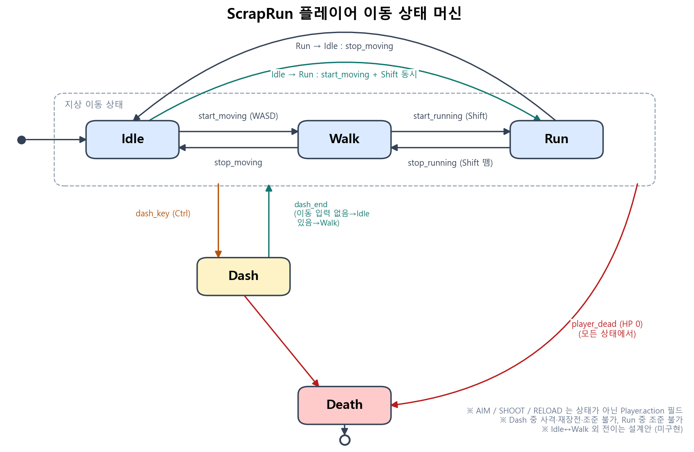
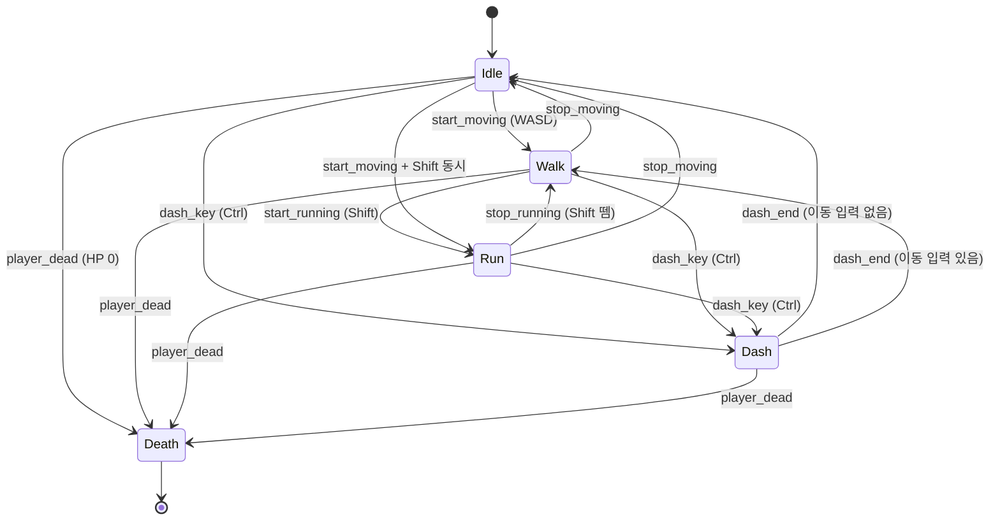

# 플레이어 상태 정리 (리소스 기반)

`resources/images/characters` 폴더의 이미지를 기준으로 정리한 플레이어 상태 목록. 구현 전 설계 문서이며 코드는 껍데기(pass)만 있다. 7번의 결정 사항이 확정되어 아래 내용에 반영되어 있다.

## 1. 스프라이트 시트 규칙
- 한 프레임 48x64, 가로 8프레임(384px).
- **6방향 시트**(384x384): right_down, right_up, up, left_up, left_down, down. 좌/우는 직전 입력 방향으로 결정 (메모.txt 규칙).
- **8방향 시트**(384x512): 위 6방향 + left, right. 조준/사격/달리기(총)처럼 마우스 방향을 보는 상태에서 사용.
- 폴더마다 시트 전체 1장 + 방향별 한 줄짜리 개별 파일(384x64)이 같이 있음. 전체 시트 1장만 써도 됨.
- 무기 변형: `Normal`(맨손) / `Gun` / `Spear`. 상태에 따라 폴더가 갈림.
- Dash, Death의 `Dust`, `Shadow` 이미지는 본체 아래에 따로 그리는 이펙트 레이어.
- 확인 필요: Dash/Death 시트의 프레임 수(가로 384px가 8프레임인지). `frame dimensions.png` 참고.

## 2. 리소스에 있는 상태 목록
| 상태 | 폴더 | 무기 변형 | 방향 | 비고 |
|---|---|---|---|---|
| Idle | Idle | Normal / Gun (Spear 미사용) | 6 | 구현 예정 (현재는 걷기 첫 프레임으로 임시) |
| Walk | Walk | Normal / Gun / Spear | 6 | 구현됨(character_test) |
| Walk_while_Aiming | Walk_while_Aiming - NEW | Gun | 8 | 우클릭 유지 중 걷기, 구현됨 |
| Walk_while_Shooting | Walk_while_Shooting - NEW | Gun | 8 | **놓친 상태** 걸으며 사격 |
| Walk_while_Reloading | Walk_while_Reloading - NEW | Gun | 8 | **놓친 상태** 걸으며 재장전 |
| Run | Run | Normal / Gun(8방향) / Spear | 6 / 8 | |
| Run_while_Shooting | Run_while_shooting | Gun | 8 | **놓친 상태** 달리며 사격 |
| Shooting (정지 사격) | Attack/Gun | Gun | 8 | **놓친 상태** 서서 사격 |
| Spear Attack | Attack/Spear | Spear | 8 | **사용 안 함** (`SpearAttack` 껍데기 pass만) |
| Reloading | Reloading | Gun | 6 | 서서 재장전 |
| Dash | Dash | Normal / Gun / Spear (+Dust, Shadow) | 6 | |
| Jump | Jump | Normal / Gun / Spear (+Dust, Shadow) | 6 | **사용 안 함** (탑다운 뷰, 상태 제거) |
| Death | Death | Normal / Gun / Spear (+Shadow) | 6 | HP 0 |

### 기존 코드/메모에 없던 상태 (추가 필요)
1. **Shooting** (정지 사격, 좌클릭)
2. **Walk_while_Shooting** (걸으며 사격)
3. **Run_while_Shooting** (달리며 사격)
4. **Walk_while_Reloading** (걸으며 재장전)
5. **Reloading** (정지 재장전, 상태 클래스에 아직 없음)
6. **Walk_while_Aiming** 은 기존 코드에서 Walk 안의 `aiming` 플래그로 처리 중 (아래 3번 설계 참고)

기존 `Attack` 상태는 이동 상태가 아니라 행동(SHOOT)으로 흡수하고, 창 공격은 `SpearAttack` 껍데기(pass)로만 남긴다 (7번 결정 참고).

## 3. 상태 설계 방향: "이동 상태 x 행동 상태" 분리
상태를 전부 개별 클래스로 만들면 조합이 폭발한다 (걷기/달리기/정지 x 조준/사격/재장전).
리소스 구성을 보면 **이동 상태(Idle/Walk/Run)** 와 **행동(없음/조준/사격/재장전)** 이 직교한다.

- **이동 상태 머신** (기존 StateMachine): Idle, Walk, Run, Dash, Death
- **행동 플래그/서브상태** (Player 필드): `action` = `NONE | AIM | SHOOT | RELOAD`
- 그리기 시 `(이동 상태, action)` 조합으로 시트를 선택:

| 이동 \ 행동 | NONE | AIM | SHOOT | RELOAD |
|---|---|---|---|---|
| Idle | Idle_Gun | Idle_Gun | Shooting | Reloading |
| Walk | Walk_Gun | Walk_while_Aiming | Walk_while_Shooting | Walk_while_Reloading |
| Run | Run_Gun | 불가 (해제) | Run_while_shooting | 불가 |
| Dash | 행동 잠금 | 불가 | 불가 | 불가 |

시트 선택표를 딕셔너리로 두고 `draw`에서 조회하면 상태 클래스 폭발을 피할 수 있다. 정지 상태 조준 전용 시트는 없으므로 **Idle+AIM은 Idle_Gun 시트를 사용**한다 (확정).

## 4. 사격 시스템: 직전 상태에 따른 반동/명중률
사격 순간에 **"직전 이동/행동 상태"** 로 정확도 계수를 결정한다. 좌클릭 즉시 사격(비조준)과 우클릭 조준 후 사격이 모두 가능.

| 사격 시점 상태 | 명중률(퍼짐 각도) | 반동 | 이동 속도 |
|---|---|---|---|
| Idle + AIM(우클릭 후) | 가장 정확 | 가장 작음 | - |
| Idle (조준 없이 좌클릭) | 보통 | 보통 | - |
| Walk + AIM | 좋음 | 작음 | 조준 배율 0.6 |
| Walk (조준 없이) | 나쁨 | 큼 | 기본 |
| Run (조준 불가) | 가장 나쁨 | 가장 큼 | 달리기 속도 |
| Dash 중 | 사격·재장전 불가 (확정, 입력 무시) | | |

구현 아이디어 (아직 구현 안 함):
- `Player.accuracy_state()` → 위 표의 키 반환
- `FIRE_PROFILE = {키: {'spread': 도, 'recoil': 값, 'kick_frames': n}}` 변수 테이블 (config 파일 없이 player.py 안에)
- 반동은 연사 시 누적 (`recoil_acc`), 사격을 멈추면 시간에 따라 회복
- 사격 시 조준 방향 = 마우스 방향 + 랜덤 퍼짐(spread + 누적 반동)
- 조준 유지 시간이 길수록 퍼짐 감소(선택)

## 5. 입력 매핑 (제안)
| 입력 | 동작 |
|---|---|
| WASD | 이동 (Idle <-> Walk) |
| WASD + Shift 동시 입력 | Run (이동 중에 Shift를 누르는 동안만. Shift만 눌렀을 때는 무반응, 이동 키를 떼면 Idle) |
| 우클릭 유지 | AIM (이동 속도 0.6배, 정확도 보너스). Run/Dash 중에는 무시 |
| 좌클릭 | 사격 (조준 여부에 따라 정확도 달라짐). Dash 중 무시 |
| R / 탄창 소진 | 재장전 (이동 중이면 Walk_while_Reloading). Run/Dash 중 불가 |
| Ctrl | Dash |
| HP 0 | Death |

## 6. 추가로 필요한 데이터
- 탄약: `ammo`, `max_ammo`, 재장전 시간(재장전 애니메이션 길이와 연동)
- HP: `hp` (Death 진입 조건)
- 무기 종류: `weapon` = `NONE | GUN` (Idle/Walk/Dash/Death 시트 선택에 사용, SPEAR는 미사용)
- 사격 쿨다운(발사 간격), 반동 누적치, 사격 중 애니메이션 프레임

## 7. 확정된 결정
1. **Run 중 조준 불가**: Run 진입 시 AIM 해제, Run 중 우클릭 무시.
2. **Idle + AIM은 `Idle_Gun` 시트 사용** (마우스 방향 8방향이 아닌 Idle 6방향 시트이므로 방향은 6방향으로 환산).
3. **Dash 중 사격, 재장전 불가** (Jump 상태는 탑다운 뷰라 제거): 해당 상태 동안 action은 NONE으로 잠금(입력 무시).
4. **Spear(근접 공격) 미사용**: 껍데기(`pass`)만 두고 구현하지 않음. 무기 종류는 `GUN` / `NONE`만 우선 사용.
5. **이동 상태 x 행동 분리 구조 채택**: 이동 상태 = StateMachine(Idle/Walk/Run/Dash/Death), 행동 = Player의 `action` 필드(NONE/AIM/SHOOT/RELOAD).

### 확정 결정 반영 후 조합표
| 이동 \ 행동 | NONE | AIM | SHOOT | RELOAD |
|---|---|---|---|---|
| Idle | Idle_Gun | Idle_Gun | Shooting | Reloading |
| Walk | Walk_Gun | Walk_while_Aiming | Walk_while_Shooting | Walk_while_Reloading |
| Run | Run_Gun | 불가 | Run_while_shooting | 불가 |
| Dash | 잠금 | 불가 | 불가 | 불가 |

## 8. 이동 상태 머신 다이어그램
행동(AIM/SHOOT/RELOAD)은 상태가 아니라 `Player.action` 필드이므로 다이어그램에 넣지 않았다. 현재 코드에서 구현된 전이는 Idle <-> Walk뿐이며, 나머지는 이 문서 기준의 설계안이다.

- Dash 중에는 action이 NONE으로 잠기고 조준/사격/재장전 입력은 무시된다.
- Run 진입 시 AIM은 해제되고, Run 중 우클릭은 무시된다.
